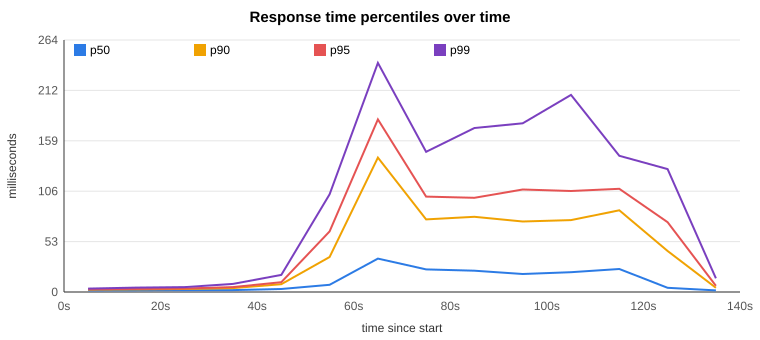
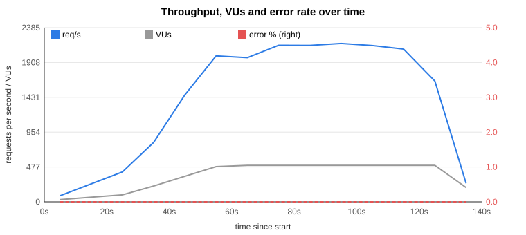

# Containerization, Kubernetes Deployment & Observability

**IT Security Management (ITSM) & DevOps – Re-examination Assignment**
Faculty of Computer Science & Engineering, Department of Information Technology
Academic Year 2025 – 2026

| | |
|---|---|
| **Name** | **[PASTE: your full name]** |
| **Student ID** | 10008308 |
| **GitHub repository** | **[PASTE: https://github.com/<user>/<repo>]** |
| **Date** | **[PASTE: submission date]** |

> How to use this draft: every place marked **[PASTE]** needs output from *your* Minikube
> run (screenshots or command output). Numbers in the "reference run" sections were measured
> with Docker Compose on a Linux test machine and are labelled as such. Do not present them
> as Minikube results.

---

## 1. Project context and objectives

The task was to take the Node.js/PostgreSQL inventory CRUD application from the course,
rewrite it in Python with Flask, package it in Docker, deploy it on Minikube and prove under
load (500 virtual users for 60 s) and under failure (crashes, pod loss) that the deployment
works. The four technical deliverables map to the DevOps workflow:
containerization → Kubernetes deployment → load testing → observability and fault tolerance.

---

## 2. Deliverable 1 – Containerization and setup

### 2.1 Flask application rewrite

`app.py` implements exactly the endpoints of `original-node-app/server.js`:

| Original (Node/Express + pg) | Flask rewrite | Behaviour kept |
|---|---|---|
| `GET /` → `index.html` | `GET /` → `templates/index.html` | same web page, unchanged |
| `POST /api/products` | `POST /api/products` | 201 + product; 400 *"Enter a valid name, quantity and price"* |
| `GET /api/products` | same | list ordered by id |
| `GET /api/products/:id` | same | 400 *"Invalid product ID"* for non-digits, 404 if missing |
| `PUT /api/products/:id` | same | updates **quantity only**; 400 / 404 as original |
| `DELETE /api/products/:id` | same | 200 *"Product deleted successfully"*, 404 if missing |
| – | `GET /health` (new) | used by Docker and Kubernetes probes |

The validation rules are the same as in the original: name required, quantity a whole number
≥ 0, price a finite number ≥ 0. `tests/functional_test.py` checks all of them, error cases
included (19 checks, all passing; see 4.1).

**Assumptions (Deliverable 1)**
- Python 3.12, Flask 3.1.3 (current supported release), gunicorn 27.0.0,
  mysql-connector-python 26.10.0. All versions are pinned in `requirements.txt`.
- The application listens on **port 3000**, the same as the original, so the web page and URLs did not change.
- **Database migration:** the `products` table is created on the first request with
  `CREATE TABLE IF NOT EXISTS`, so no migration tool is needed. The PostgreSQL types were
  translated: `GENERATED ALWAYS AS IDENTITY` → `BIGINT AUTO_INCREMENT`, `NUMERIC(10,2)` →
  `DECIMAL(10,2)`, and the `CHECK` constraints were kept (MySQL ≥ 8.0.16 enforces them).
- Ids are returned as strings and prices as numbers, as the original read endpoints do.
- **Environment variables:** `DB_HOST`, `DB_PORT`, `DB_USER`, `DB_PASSWORD`, `DB_NAME`,
  `GUNICORN_WORKERS`, `GUNICORN_THREADS`, and optionally `DB_POOL_SIZE` (default = threads).
- `/health` does **not** query MySQL. If the database is down, restarting the Flask
  container would not fix it, and the API already reports the problem with HTTP 500.

### 2.2 Database

The official `mysql:8.4` image (LTS) is used.
- `--skip-log-bin`: there is only one server and no replication, so no binary log is needed.
- `--innodb-flush-log-at-trx-commit=2`: the redo log is flushed once per second instead of on
  every commit. *Assumption/trade-off:* up to about 1 s of writes can be lost if the whole
  node crashes. That is acceptable for this project, but not for financial data.
- `--max-connections=300`: there is headroom for the worst case of 80 application connections (see 4.4).

Database access goes through a connection pool per gunicorn worker, with pool size equal to
the number of threads. A worker can never run more queries at once than it has threads, so
the pool can never run dry. mysql-connector raises `PoolError` immediately when the pool is
empty. Connections use `autocommit`, so a pooled connection never keeps an old read snapshot,
and the per-request session reset (an extra round trip) can be skipped.

### 2.3 Dockerfile

- **Multi-stage:** `python:3.12` (full image, with compilers) installs the dependencies into
  `/install`. Only that directory is copied into `python:3.12-slim`, so the final image
  contains no build tools.
- **Production server:** gunicorn (`gunicorn.conf.py`), not `flask run`.
- **Non-root:** the container runs as `appuser` (uid 10001). Verified with `docker exec flask-crud-app id`,
  which printed `uid=10001(appuser)`.
- `EXPOSE 3000`. `PYTHONUNBUFFERED=1` so logs appear immediately in `docker logs` / `kubectl logs`.

### 2.4 Docker Compose

`docker-compose.yaml` defines `app` and `db` (`mysql:8.4`) on the named bridge network
`crud-network`, with the named volume `mysql-data` mounted at `/var/lib/mysql`.
- The `app` healthcheck probes `/health`. `db` has a `mysqladmin ping` healthcheck.
- `depends_on: condition: service_healthy` starts the app only once MySQL accepts connections.
- `restart: unless-stopped` restarts crashed containers.

Evidence:

```
NAME                  STATUS
flask-crud-app        Up 6 seconds (healthy)
flask-crud-database   Up 11 seconds (healthy)
```
**[PASTE: screenshot of `docker compose ps` on your machine]**

---

## 3. Deliverable 2 – Kubernetes deployment

### 3.1 Deployment manifest (`k8s/deployment.yaml`)

| Requirement | Implementation |
|---|---|
| apiVersion / kind | `apps/v1` / `Deployment` |
| metadata | name `flask-crud-app`, namespace `default`, labels `app: flask-crud-app`, `tier: backend` |
| `spec.replicas` | **1** (the HPA in 5.2 can scale it out under load) |
| selector | `matchLabels: app: flask-crud-app`, the same labels as the pod template |
| resources | requests `cpu: 500m, memory: 256Mi`; limits `cpu: 2, memory: 512Mi` |
| startupProbe | `GET /health` every 2 s, up to 30 failures (60 s to boot) |
| readinessProbe | `GET /health` every 5 s, timeout 5 s, 6 failures before the pod leaves the Service |
| livenessProbe | `GET /health` every 10 s, timeout 5 s, 6 failures (~60 s) before a restart |
| security | `runAsNonRoot: true`, `allowPrivilegeEscalation: false` |
| credentials | `DB_USER`, `DB_PASSWORD`, `DB_NAME` from the Secret `mysql-credentials` |

*Why the requests and limits:* the request (500m CPU, 256 Mi) is what the scheduler
reserves, and the HPA's 100 %. The limit of 2 CPUs lets the 4 gunicorn processes burst under
load. The 512 Mi memory limit is about 3.5× the measured peak (≈150 Mi), so a memory leak
would cause an OOM-kill and restart rather than starve the node.

*Why generous readiness settings:* under load, the probe request waits in the same queue as
real requests. A readiness probe that times out too quickly removes the only pod from the
Service in the middle of the test. Every new connection is then refused, which is what
happened in the first test run (4.5).

`k8s/mysql.yaml` contains:
- a `PersistentVolumeClaim` (1 Gi), so data survives pod restarts;
- a `Deployment` with `strategy: Recreate`, so two MySQL processes never open the same data directory;
- `mysqladmin ping` readiness and liveness probes, and resource requests and limits;
- a `ClusterIP` Service (the database must not be reachable from outside the cluster).

`k8s/secret.yaml` holds the credentials. *Assumption:* a Kubernetes Secret is only
base64-encoded. That is acceptable on a local Minikube, but production would need
encryption at rest or an external secret manager, and no real password in Git.

### 3.2 Service manifest (`k8s/service.yaml`) and choice of type

`flask-crud-service` is of type **NodePort** (port 3000 → nodePort 30080).

| Type | Reachable from | Why (not) chosen |
|---|---|---|
| ClusterIP | inside the cluster only | the browser and the k6 load generator run outside the cluster |
| **NodePort** | `<node-ip>:30080` | works on Minikube without extra components. k6 can target it directly on the Minikube Docker network. Still includes a ClusterIP for in-cluster access |
| LoadBalancer | external IP from a cloud LB | needs a cloud provider or `minikube tunnel`; the tunnel on Windows cannot carry 500 concurrent connections |

The MySQL service is **ClusterIP**: only the application pods need it.

### 3.3 Minikube deployment and verification

```
minikube addons enable metrics-server
minikube image build -t flask-crud-app:1.0 .
kubectl apply -f k8s/secret.yaml -f k8s/mysql.yaml
kubectl apply -f k8s/deployment.yaml -f k8s/service.yaml -f k8s/hpa.yaml
kubectl get pods,services,hpa -o wide
python tests/functional_test.py http://<minikube-ip>:30080
```
(also available as `scripts/deploy-minikube.ps1`). All manifests were validated against the
Kubernetes 1.32 schema with `kubernetes-validate --strict`.

**[PASTE: screenshot / output of `kubectl get pods,services,hpa -o wide`]**
**[PASTE: output of `python tests/functional_test.py http://<minikube-ip>:30080` – 19/19 passed]**
**[PASTE: screenshot of the web page at http://<minikube-ip>:30080]**

---

## 4. Deliverable 3 – Functional validation and load testing

### 4.1 Functional validation

`tests/functional_test.py` (standard library only) checks every endpoint:
- create → read all → read one → update (also with the same value) → delete;
- 404 after deletion for GET, PUT and DELETE;
- each validation rule: missing or null name, negative or decimal quantity, negative price,
  invalid update quantity, and non-numeric id for GET, PUT and DELETE.

Result against Docker Compose: **19/19 checks passed**. **[PASTE: same against Minikube]**

### 4.2 Load test scenario (`k6/load-test.js`)

| Parameter | Value |
|---|---|
| Tool | Grafana k6 (container `grafana/k6`, on the `minikube` Docker network) |
| Virtual users | ramp 0→100 (30 s) → 500 (30 s), **hold 500 VUs for 60 s**, ramp down 15 s |
| Per iteration | full CRUD cycle: POST → GET all → GET one → PUT → DELETE, then 1 s think time |
| Captured | latency (avg, p50, p90, p95, p99, max), error rate (total and per operation), throughput (req/s) |
| Thresholds | failed requests < 1 %, p95 < 2 s, each CRUD operation < 1 % errors |
| Output | console summary, `summary.json`, `report.html` (k6 web dashboard with charts over time), `raw.csv` |

Each user deletes the product it created, so the table stays small and "read all" measures
the service, not a table that grows during the test (*assumption:* realistic for a store
where products come and go).

All `/api/products/<id>` URLs are grouped under one name (`/api/products/:id`). Without this,
every id became its own metric series (over 800,000 in two minutes, k6 warned about it),
which made k6 itself slow and memory-hungry.

`scripts/run-load-test.ps1` runs k6 and records `kubectl top pods` every 5 s.
`k6/analyze_results.py` then turns the raw data into the tables and SVG charts below.

### 4.3 Results

#### a) Minikube (the graded environment)
**[PASTE: `k6/results/results-tables.md` overall + over-time tables from your Minikube run]**
**[PASTE: `k6/results/latency-over-time.svg` and `errors-throughput-over-time.svg`]**
**[PASTE: CPU/memory per pod table and `pod-cpu-over-time.svg`]**
**[PASTE: `kubectl get hpa` during the test (`k6/results/hpa-during-test.txt`)]**

#### b) Reference run – Docker Compose, Linux test machine (4 vCPU)
The app container was limited to the same 2 CPU / 512 Mi as the Kubernetes pod. Full output
is in `docs/reference-run/`.

| Requests | Throughput | Failed | p50 | p90 | p95 | p99 | max |
|---:|---:|---:|---:|---:|---:|---:|---:|
| 195,870 | 1,442 req/s | 0.00 % | 12 ms | 71 ms | 99 ms | 178 ms | 309 ms |

Over time (10 s windows):

| Window | VUs | req/s | Error rate | p50 | p95 | p99 |
|---|---:|---:|---:|---:|---:|---:|
| 0-10s | 30 | 84 | 0.00 % | 2 ms | 3 ms | 4 ms |
| 20-30s | 96 | 410 | 0.00 % | 2 ms | 4 ms | 5 ms |
| 40-50s | 350 | 1464 | 0.00 % | 3 ms | 10 ms | 18 ms |
| 60-70s | 500 | 1975 | 0.00 % | 35 ms | 181 ms | 240 ms |
| 80-90s | 500 | 2142 | 0.00 % | 22 ms | 99 ms | 172 ms |
| 100-110s | 500 | 2140 | 0.00 % | 21 ms | 106 ms | 207 ms |
| 120-130s | 500 | 1654 | 0.00 % | 4 ms | 73 ms | 129 ms |




| Container | Avg CPU | Max CPU | Avg memory | Max memory |
|---|---:|---:|---:|---:|
| flask-crud-app (limit 2 CPU / 512 Mi) | 1411m | ~2000m (= limit) | 131 Mi | 151 Mi (29 %) |
| mysql (limit 2 CPU / 1 Gi) | 430m | 671m | 480 Mi | 482 Mi (47 %) |

### 4.4 Analysis – CPU-bound or memory-bound?

**The application tier is CPU-bound, not memory-bound.**
- During the 500-VU hold, the app container sat at its **2-CPU limit** for the whole phase
  (CPU chart), while memory stayed flat at ~130–150 Mi, below 30 % of the limit.
- MySQL used about a third of its CPU and a stable ~480 Mi: the database was not the bottleneck.
- Latency rose exactly when CPU reached the limit (60–70 s window, p95 181 ms). Throughput
  levelled off at ~2,100 req/s while VUs stayed at 500. That is the saturation point of one
  pod on that machine.

**Relation to the gunicorn configuration (4 workers × 4 threads = 16 concurrent requests):**
- Python's GIL lets each worker *process* use at most one CPU core. 4 workers can use up to
  4 cores, but the pod limit is 2, so the workers compete for 2 cores and get throttled.
  More workers would not help, because the CPU limit is the ceiling. Fewer than 2 would leave
  CPU unused.
- Threads help while a request waits for MySQL, since waiting releases the GIL. In this
  workload the queries take a few milliseconds, so most time is spent in Python CPU work
  (JSON, Flask routing, the MySQL protocol). More threads would only queue more requests
  behind the same 2 cores, raising latency without raising throughput.
- **The fix for more load is horizontal**: more pods, each with its own 2-CPU budget. This is
  why the HPA targets CPU (5.2) and not memory.
- Demand model: each VU sends 5 requests and then sleeps 1 s. With 500 VUs and low latency,
  that is up to 500 × 5 / (1 s + 5 × latency) ≈ 2,200 req/s. Throughput can only reach that
  if latency stays low, which requires enough CPU.

**[PASTE/ADAPT: the same reasoning with your Minikube numbers. On Windows, Minikube runs inside
Docker Desktop's VM and traffic goes through kube-proxy, so expect lower absolute throughput
than the reference run. Compare your pods' CPU to the 2000m limit and memory to 512 Mi.]**

Did the infrastructure handle the load satisfactorily? In the reference run, yes: 0 errors
and p95 of 99 ms, far under the 2 s target. **[PASTE: your verdict for Minikube]**

### 4.5 First Minikube run – failure analysis (honest account)

The first 500-VU run on Minikube (`docs/reference-run/first-minikube-run-summary.json`) failed:

| Metric | Value |
|---|---|
| Requests | 11,548 (237 req/s) |
| Failed requests | 4,872 (**42 %**) |
| CREATE (POST) failures | 4,872 of 6,321 (77 %) |
| READ / UPDATE / DELETE failures | **0** |
| p95 latency | 2.40 s (threshold 2 s crossed) |

What the numbers show:
1. **Every failure was a CREATE.** No read, update or delete ever failed.
2. **The failed requests took ≈ 0 ms.** Average latency over all requests was 814.6 ms and
   over successful requests 1,409 ms. 814.6 × 11,548 ≈ 1,409 × 6,676, so the 4,872 failures
   contributed almost no time. Requests that fail in 0 ms got **no HTTP response at all**
   (k6 status 0, connection refused), so the application never saw them.
3. The median iteration lasted exactly 1.0 s: fail immediately, sleep 1 s, try again.

Explanation consistent with all three facts:
- The deployment used a readiness probe on `/ready`, an endpoint `app.py` does not have
  (404). Even with that endpoint, a 5 s probe timeout fails under load.
- Once the pod is not ready, Kubernetes removes it from the Service endpoints. kube-proxy then
  **refuses new connections, but keeps already-open connections working**.
- In k6, CREATE is the first request of an iteration, and the one that opens a new
  connection after a failure. So VUs with a live keep-alive connection completed whole CRUD
  cycles, while every VU that needed a new connection failed at CREATE, instantly and repeatedly.

Fixes applied:
- All probes point to the existing `/health`. Readiness has a 5 s timeout and needs 6
  failures, so a busy pod is not taken out of the Service. A separate startupProbe covers the boot time.
- An HPA (1–5 pods) adds CPU when the single pod saturates.
- The k6 script groups URLs by name (the metric explosion above) and logs the first failures
  with their error text, so a status-0 failure shows its cause directly.

A control experiment supports this: the original code, with the original k6 script, without
Kubernetes in between (Docker network, 2 CPU) handled 1,254 req/s with 0 failures. The
problem was in the deployment, not in the Flask code. After the changes, the same machine
achieved 1,442 req/s (+15 %) with p95 down from 172 ms to 99 ms.

**[PASTE: your second Minikube run after these fixes, with error rate and p95]**

---

## 5. Deliverable 4 – Observability and fault tolerance

### 5.1 Self-healing (`scripts/fault-tolerance.ps1`, output in `k6/results/fault-tolerance.txt`)

| Test | How | Expected (Kubernetes mechanism) |
|---|---|---|
| A. Process crash | `kubectl exec <pod> -- sh -c "kill 1"` stops gunicorn (PID 1) | Container exits. The kubelet restarts it **in the same pod** (`restartPolicy: Always`); **RESTARTS 0 → 1** |
| B. Pod loss | `kubectl delete pod <pod>` | The ReplicaSet sees 0 of 1 desired pods and creates a **new pod** (new name). The readiness probe gates traffic until it answers `/health` |
| C. Database outage | `kubectl delete pod <mysql-pod>` | API returns HTTP 500 *"Could not read products"* (no crash, no restart of the app). After MySQL is back, requests succeed again and the data is still there (PVC) |
| D. Hang (explained) | process alive but not answering | livenessProbe fails 6 × 10 s, then the kubelet kills and restarts the container |

Verified with Docker: after `kill 1`, the container came back with `RestartCount=1`, and
gunicorn booted 4 new workers.

**[PASTE: `kubectl get pods` before and after test A, showing RESTARTS increasing]**
**[PASTE: output of tests B and C from `k6/results/fault-tolerance.txt`]**

### 5.2 Horizontal Pod Autoscaler (`k8s/hpa.yaml`)

- Scales `flask-crud-app` between **1 and 5 replicas** to keep average CPU at **60 % of the
  request** (60 % × 500m = 300m per pod).
- *Why CPU:* 4.4 shows the app is CPU-bound, while memory barely changes with load.
- *Why 60 % and not 80 %:* a new pod needs ~10–20 s to start and pass readiness. Scaling
  earlier leaves headroom for the existing pods during that time.
- *Why max 5:* 5 pods × 4 workers × 4 pooled connections = 80 MySQL connections, well
  below `max_connections = 300`. 5 × 500m requested CPU = 2.5 cores, which fits a 4-CPU
  Minikube node next to MySQL.
- `behavior.scaleUp.stabilizationWindowSeconds: 0` and +2 pods per 15 s: the test lasts about
  2 minutes, so the default scale-up would react too late. Scale-down waits 120 s so pods are
  not removed during a short dip.
- *Limitation:* metrics-server samples every ~15 s, so the first 30–60 s of the ramp are always
  served by fewer pods. The warm-up stage in the load test gives the HPA time to react.

**[PASTE: `kubectl get hpa -w` during the load test, showing REPLICAS rising]**

### 5.3 Monitoring used
- `kubectl top pods/nodes` (metrics-server), every 5 s during the test, saved as `pod-usage.csv`.
- k6 web dashboard export (`report.html`): latency percentiles, request rate and failures over time.
- `kubectl get pods -w`, `kubectl describe pod` (restart count, last state, probe events),
  `kubectl logs deployment/flask-crud-app` (gunicorn and database errors are logged with stack traces).

---

## 6. Reflective summary

**What worked:**
- The Flask rewrite keeps the original API and validation (19/19 functional checks).
- The image is multi-stage, non-root and served by gunicorn.
- Compose and Kubernetes both use health-checked services, and data persists on a volume.
- Under 500 VUs in the reference run: 0 % errors and p95 ≈ 0.1 s.

**What went wrong and what I learned:**
- The first Minikube test failed with 42 % errors. The cause was not the Python code but
  the readiness probe: a probe on a missing or slow endpoint silently takes the only pod out
  of the Service, and only *new* connections fail. That is why only one of five operations
  appeared broken.
- A load-testing tool can distort its own measurement: unique URLs created 800,000+ metric series.
- The app is CPU-bound. Adding threads or database connections does not help; more CPU,
  meaning more pods, does. Pool size = threads per worker keeps the total number of
  MySQL connections predictable (80 at most).

**Limitations:**
- Single-node Minikube: app pods, MySQL and (if run in-cluster) k6 share one machine, so the
  results do not show the capacity of a real multi-node cluster.
- MySQL is a single instance, with no replication or backup.
- Secrets are only base64-encoded.

**[PASTE/ADAPT: anything else you encountered on your machine]**

---

## 7. Repository structure

See `README.md`. All required files are in the repository: `Dockerfile`,
`docker-compose.yaml`, `k8s/*.yaml` (Deployment, Service, MySQL, Secret, HPA),
`k6/load-test.js` and the results, plus `tests/functional_test.py` and the scripts used.
